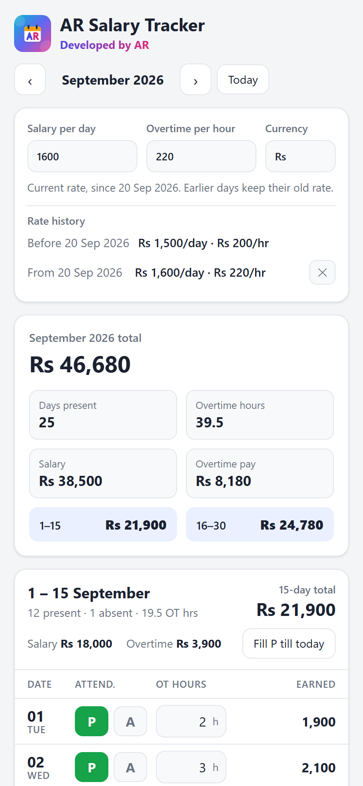
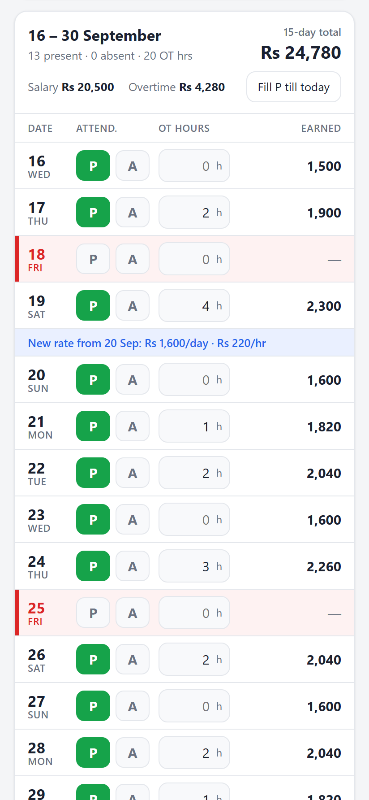

  

<h1 align="center">AR Salary Tracker: Free Daily Wage &amp; Overtime Calculator</h1>

  <b>A free Android app for factory and daily-wage workers to track attendance, overtime hours, and 15-day &amp; monthly salary.</b> 
  Works offline · No sign-up · No ads · English &amp; اردو

  
  
  

  
  &nbsp;
  

## What is AR Salary Tracker?

AR Salary Tracker is a **daily wage calculator** and **overtime calculator** for people who are paid by the day, such as factory workers, labourers and contract workers. Enter your salary per day and overtime rate once. Then mark each day you work and add your overtime hours, and the app shows exactly how much you have earned every 15 days and every month, so you can check your pay slip.

## Features

- ✅ **Daily attendance**: tap **P** (present) or **A** (absent) for each day
- ⏱️ **Overtime calculator**: overtime pay = overtime hours × overtime rate per hour
- 💰 **15-day and monthly totals**: 1–15, 16 to month end, and the full month
- 📅 **Fridays in red**: your usual day off is easy to spot
- 📈 **Salary increase support**: a new rate starts from the date you choose, and earlier days keep the old rate
- 🔒 **Private and offline**: data stays on your phone, with backup and restore
- 🌐 **Online version** for iPhone and computers: [use it in your browser](https://abdurrehman629.github.io/salary-tracker/app/)

## Download and install (Android 8+)

1. **[Download AR-Salary-Tracker.apk](https://github.com/ABDURREHMAN629/salary-tracker/releases/latest/download/AR-Salary-Tracker.apk)** on your phone (about 25 KB).
2. Open the file. If the phone asks, turn on **Allow from this source**.
3. Tap **Install**. If Play Protect warns about an unknown app, tap **More details → Install anyway**. The app is not on the Play Store yet, needs no permissions, and does not use the internet.

To update, download the newest file from the same link and install it over the old app. Your data stays.

## اردو: دیہاڑی اور اوور ٹائم کا آسان حساب

AR سیلری ٹریکر فیکٹری اور دیہاڑی پر کام کرنے والے مزدوروں کے لیے ایک مفت ایپ ہے۔ جس دن کام پر جائیں P دبائیں، اوور ٹائم کے گھنٹے لکھیں، اور ہر 15 دن اور پورے مہینے کی تنخواہ کا حساب خود بخود دیکھیں۔ دیہاڑی بڑھ جائے تو نیا ریٹ اسی تاریخ سے لگے گا، پرانے دنوں کا حساب نہیں بدلے گا۔ انٹرنیٹ کی ضرورت نہیں، آپ کا ڈیٹا صرف آپ کے فون میں رہتا ہے۔

**[مفت ڈاؤن لوڈ کریں (اینڈرائیڈ)](https://github.com/ABDURREHMAN629/salary-tracker/releases/latest/download/AR-Salary-Tracker.apk)**

*Roman Urdu: Dihari, tankhwah aur overtime ka asaan hisaab. Factory workers ke liye muft Android app.*

## FAQ

**Is it free?** Yes, completely free, with no ads and no sign-up.

**Does it need internet?** No. It works fully offline after installing.

**Is my data private?** Yes. Everything is saved only on your phone. Use **Download backup** to keep a copy.

**My wage increased. Will old days change?** No. Type the new rate and pick the date it starts. Days before it keep the old rate.

**Does it work on iPhone?** The APK is for Android. On iPhone or a computer, use the [online version](https://abdurrehman629.github.io/salary-tracker/app/).

## Contact the developer

**Developed by AR**

- 📞 Call / WhatsApp: [+92 324 7440629](https://wa.me/923247440629)
- ✉️ Email: [gabdurehman493@gmail.com](mailto:gabdurehman493@gmail.com)

## For developers

| Path | What it is |
| --- | --- |
| `app/index.html` | The whole app: one HTML file (HTML, CSS, JavaScript), no build step |
| `android/` | Android wrapper (WebView). `bash android/build.sh` builds the APK, `bash android/build.sh install` also installs it over USB |
| `index.html` | Website / landing page (GitHub Pages) |
| `assets/` | Logo, icon, screenshots, link-preview image |
| `tools/make-images.sh` | Regenerates the screenshots and preview image with headless Microsoft Edge |
| `PROJECT_SUMMARY.md` | Full project notes: how everything works and how to continue |

Building the APK needs Android Studio (for its SDK build-tools and bundled Java). The signing key is kept out of git on purpose.

Keywords: daily wage calculator, overtime calculator, salary calculator app, dihari calculator, attendance tracker, factory worker salary, labour wage app, 15 days salary calculator, Pakistan, Urdu, تنخواہ کیلکولیٹر، اوور ٹائم کیلکولیٹر
